# S12 POS (启明星多语言软件): installing on a new laptop

This guide sets up the S12 multi-language POS ("Sales System") on a new Windows laptop, using SQL Server 2022 Express as its database. It follows a real installation done on 15 Oct 2026; the screenshots are from that install.

> **Before you start:** you need a Windows 10/11 laptop with admin rights, and the installer bundle.

## Download the installer bundle

The installers are too big to keep in the repo itself, so they're attached to a release:

1. Open the [**v12.5 release**](https://github.com/omoinjm/s12-pos-setup-guide/releases/tag/v12.5) and download **`s12-pos-installer-bundle.zip`** (about 430 MB). This is the original `启明星多语言软件.zip`, renamed.
2. Extract it. You'll get a `启明星多语言软件` folder containing the files listed below.

---

## What's in the bundle

| File | What it is | Needed? |
|---|---|---|
| `SQL2022-SSEI-Expr.exe` | SQL Server 2022 Express installer (the database) | **Yes, install first** |
| `POS_OM_ML 12.5-B16.8290.exe` | The POS program, v12.5 | **Yes** |
| `POS2026.bak` | Backup of an existing POS database (database name `POS2026`) | Only if you want the old data |
| `vs_SSMS.exe` | SQL Server Management Studio (database admin tool) | Optional |
| `PP4b.exe`, `PP4-6.205.apk` | Companion app (PC / Android handheld) | No |
| `SunloginClient_…exe` | Remote-desktop tool so the vendor can connect | Only if the vendor asks |
| `S12POS商超版教学1-6课视频（英文）.rar` | Training videos (English) | Useful reference |
| `S12POS商超版教学1-6课视频（中文）.zip` | Training videos (Chinese) | Optional |
| `S12多语言软件POS版简介.pptx` | Product introduction slides | Optional |

> The POS installer is in a folder whose name shows up garbled (e.g. `╞Ї├ў╨╟╢р╙я╤╘╚э╝■`). That's the same Chinese folder name decoded wrongly when the zip was extracted. It's safe to ignore.

---

## Step 1: Install SQL Server 2022 Express

1. Run `SQL2022-SSEI-Expr.exe` and choose the **Basic** installation.
2. When it finishes, note the **Instance name**, which should be `SQLEXPRESS`.
3. Click **Connect Now**. This opens a **SQLCMD** window, which you'll use in Step 3. Leave it open.

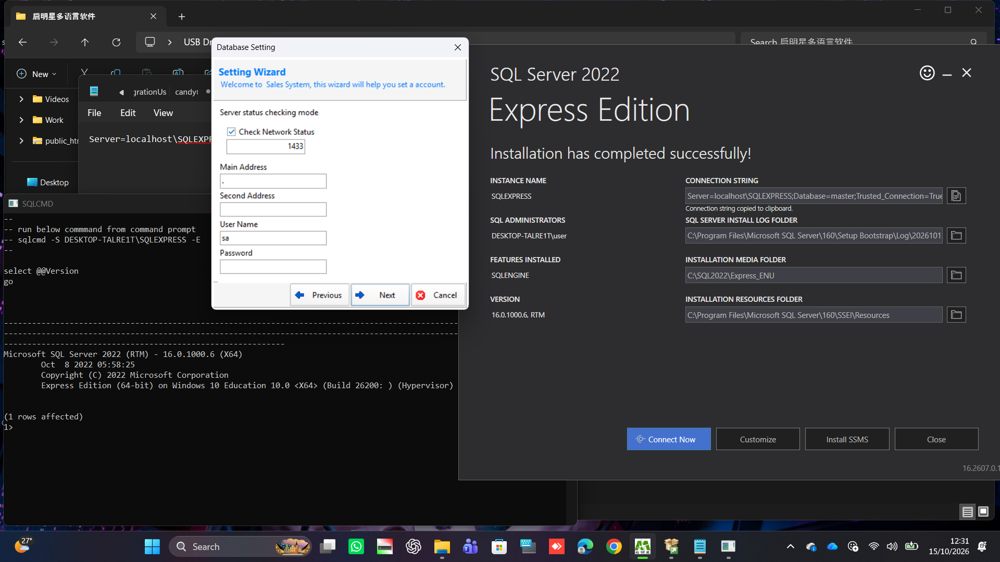

## Step 2: Install the POS

Run `POS_OM_ML 12.5-B16.8290.exe` and follow the installer. When the POS starts for the first time it opens a **Database Setting** wizard. **Don't fill it in yet.** SQL Server needs the changes in Steps 3–5 first.

## Step 3: Enable the `sa` login

By default SQL Server Express only allows Windows logins. The POS logs in as `sa`, so password logins have to be switched on.

In the **SQLCMD** window, type each line below and press **Enter** after each one. Use your own strong password: upper and lower case, a number and a symbol.

```sql
EXEC xp_instance_regwrite N'HKEY_LOCAL_MACHINE', N'Software\Microsoft\MSSQLServer\MSSQLServer', N'LoginMode', REG_DWORD, 2
ALTER LOGIN sa WITH PASSWORD = 'YourStrongPassword1!'
ALTER LOGIN sa ENABLE
GO
```

> ⚠️ **`GO` must be on its own line.** If it's at the end of another line, SQLCMD just shows `2>`, `3>`… and nothing runs. If that happens, type `:reset`, press Enter, and type the lines again.
>
> ⚠️ Simple passwords like `qwerty` are rejected.

**Write the `sa` password down.** You'll need it in Step 6.

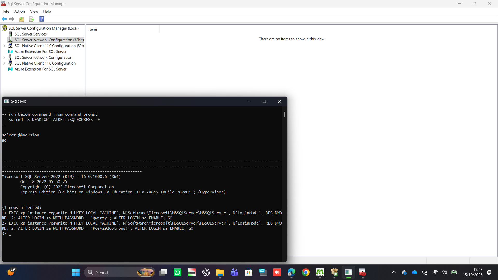

## Step 4: Enable TCP/IP on port 1433

1. Press **Win + R**, type `SQLServerManager16.msc` and press Enter.
2. Expand **SQL Server Network Configuration**. Use the one **without** "(32bit)"; the 32-bit one is always empty.
3. Click **Protocols for SQLEXPRESS**. Right-click **TCP/IP** and choose **Enable**.
4. Double-click **TCP/IP** and open the **IP Addresses** tab. Scroll to **IPAll** and set:
   - **TCP Dynamic Ports**: *(empty)*
   - **TCP Port**: `1433`
5. Click **OK**.

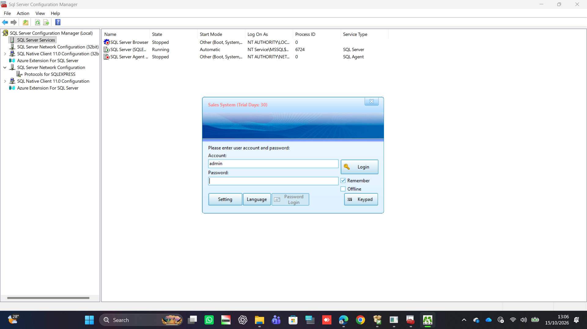

## Step 5: Restart SQL Server

Open **Command Prompt as Administrator** and run:

```
net stop MSSQL$SQLEXPRESS && net start MSSQL$SQLEXPRESS
```

You can also go to Configuration Manager → **SQL Server Services**, right-click **SQL Server (SQLEXPRESS)** and choose **Restart**.

## Step 6: Connect the POS to the database

On the POS login window, click **Setting** to open **Database Setting**.

**General tab:**

| Field | Value |
|---|---|
| Account Name | `Sales System` (default) |
| Database Type | **SQL SERVER** |
| Main Address | `.\SQLEXPRESS` |
| Second Address | *(empty)* |
| Port | `1433` |
| User Name | `sa` |
| Password | the `sa` password from Step 3 |
| Database Name | `POS` |

Click **Server Connection Test** and then **Database Test** to check the settings.

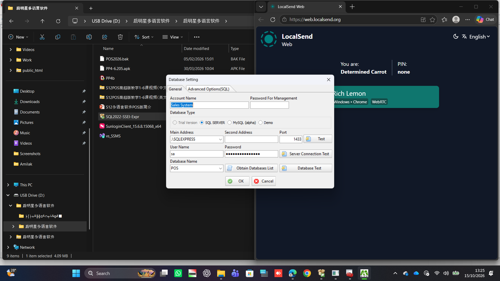

> **Don't use `.` as the Main Address.** It points to a default SQL instance, which doesn't exist here. If `.\SQLEXPRESS` doesn't work, try `127.0.0.1,1433`.

**Advanced Options (SQL) tab:** if the database doesn't exist yet, click **New Database** here. To load old data instead, use **Restore Database** (see [Restoring old data](#optional-restoring-old-data)).

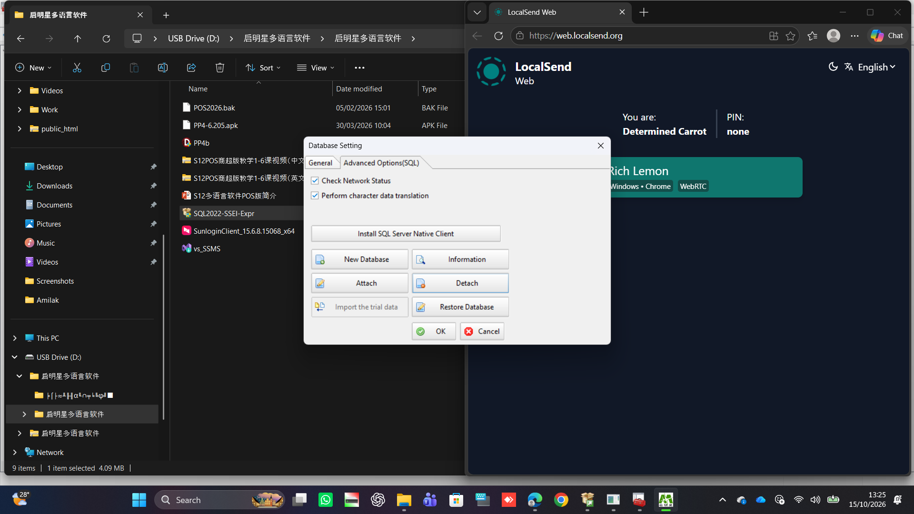

Click **OK**.

### Database upgrade error log

When the POS upgrades the database tables, it may show this:

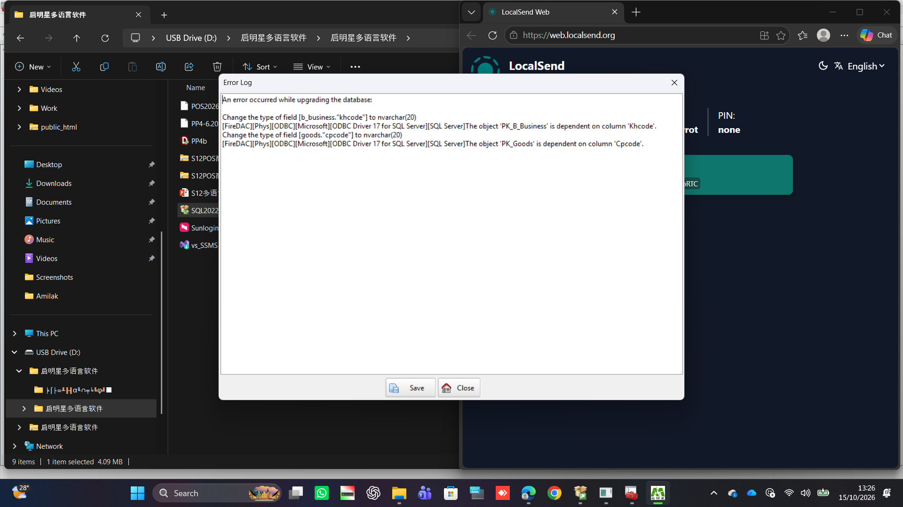

```
Change the type of field [b_business."khcode"] to nvarchar(20)
… The object 'PK_B_Business' is dependent on column 'Khcode'.
Change the type of field [goods."cpcode"] to nvarchar(20)
… The object 'PK_Goods' is dependent on column 'Cpcode'.
```

Two columns (customer code and product code) couldn't be converted because each one is part of its table's primary key. **The POS still works.** The only effect is that those two codes can't hold non-Latin characters, such as Chinese or Amharic. Click **Close** and continue. Report it to the vendor if you need non-Latin codes.

## Step 7: Bind this laptop as a till (terminal)

The first time you log in on a new computer, the POS asks you to bind the computer to a **terminal number**.

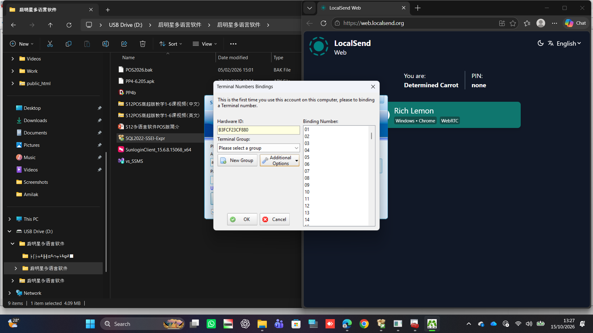

1. If **Terminal Group** is empty, click **New Group** and fill in the tabs below.

   **Group Information:** Group Code `MN`, Group Name `Main`, Default Warehouse **Main Warehouse**, Default Price **Retail Price**, Account **Cash**. Fill in **Price System** if its dropdown has an option.

   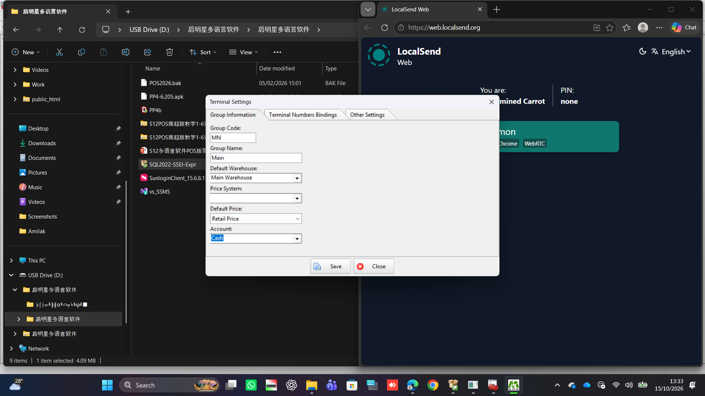

   **Terminal Numbers Bindings:** leave it empty. It fills in automatically.

   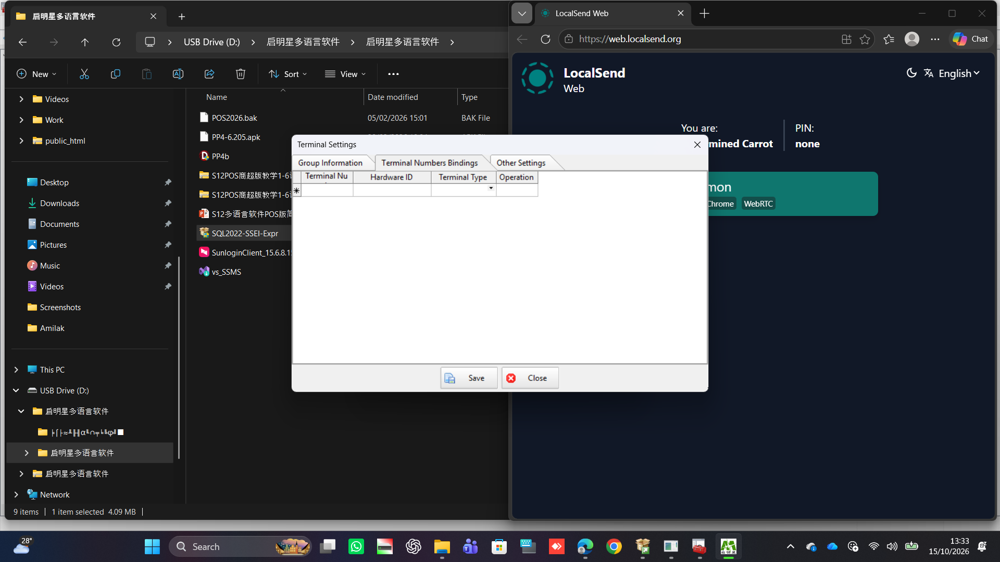

   **Other Settings:** these details print on receipts. Fill in Shop Name, Contact Information (phone), Company Address and a Footer (e.g. "Thank you for shopping with us!"), and choose the **Tax Type**. You can change all of these later.

   

   Click **Save**, then **Close**.

2. Choose the **Main** group, click Binding Number **01** and click **OK**.

   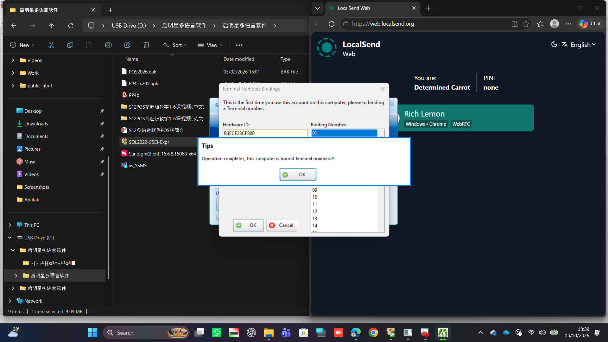

   > Each till needs its own number. A second laptop or handheld would be `02`, and so on.

3. **Select IME:** choose **None** and click **OK**. This keeps the normal keyboard, which is what you want for English typing and barcode scanners.

   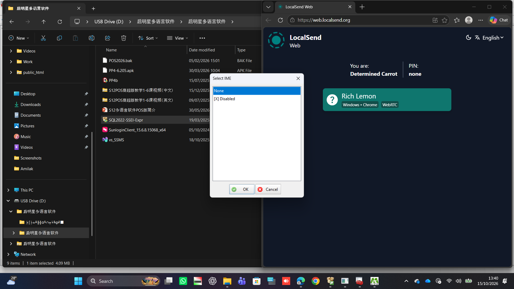

## Step 8: Initial setup wizard (tax and backups)

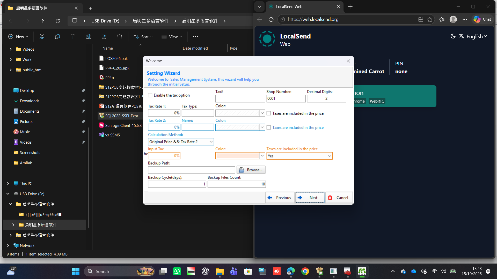

**Tax:**

- **If the shop is VAT-registered:**
  - Tick **Enable the tax option**.
  - Enter your VAT number in **Tax#**.
  - Set **Tax Rate 1** to your VAT rate (e.g. `15` in South Africa) and **Tax Type** to `VAT`.
  - Tick **Taxes are included in the price** if your shelf prices include VAT.
  - Leave Tax Rate 2 at `0%` unless you charge a second tax.
  - Set **Input Tax** (VAT on supplier purchases) to the same rate.
- **If the shop isn't VAT-registered:** leave the tax option unticked and every rate at `0%`.
- If you're not sure, ask your accountant. These settings change receipt totals.

**Keep the defaults for:** Shop Number `0001`, Decimal Digits `2`.

**Backups (important):**

| Field | Value |
|---|---|
| Backup Path | `C:\Program Files\Microsoft SQL Server\MSSQL16.SQLEXPRESS\MSSQL\Backup` |
| Backup Cycle (days) | `1` |
| Backup Files Count | `10` |

SQL Server can always write to that folder; it may not have permission to write elsewhere. **Copy those files to a USB stick or cloud storage regularly.** Backups that stay on the laptop are lost if the laptop is.

Click **Next** and finish the remaining pages of the wizard.

> If you skip or cancel this wizard, the login window shows *"You did not complete the initial Setup, the Sales Center cannot use."* Click **Setting** again and finish every page.
>
> 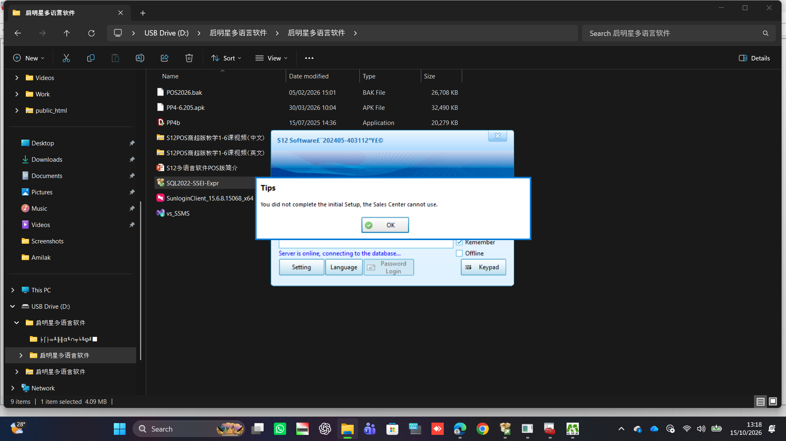

## Step 9: Log in

Log in as **`admin`**. If you didn't set a password during setup, try leaving it blank. If that doesn't work, ask the vendor for the default admin password.

---

## Optional: restoring old data

`POS2026.bak` is a full POS database named **`POS2026`**. Restore it **before** you enter any sales, because restoring replaces the database.

**Using the POS (easiest):** go to Setting → **Advanced Options (SQL)** → **Restore Database**, select `POS2026.bak`, then set **Database Name** to `POS2026` on the General tab.

**Using SQLCMD:**

1. Copy `POS2026.bak` to `C:\Program Files\Microsoft SQL Server\MSSQL16.SQLEXPRESS\MSSQL\Backup\`.
2. In SQLCMD, type each line and press Enter after each:

   ```sql
   RESTORE DATABASE POS2026 FROM DISK = 'C:\Program Files\Microsoft SQL Server\MSSQL16.SQLEXPRESS\MSSQL\Backup\POS2026.bak'
   WITH MOVE 'InitDB' TO 'C:\Program Files\Microsoft SQL Server\MSSQL16.SQLEXPRESS\MSSQL\DATA\POS2026.mdf',
   MOVE 'InitDB_log' TO 'C:\Program Files\Microsoft SQL Server\MSSQL16.SQLEXPRESS\MSSQL\DATA\POS2026_log.ldf', REPLACE
   GO
   ```

3. In the POS, set **Database Name** to `POS2026`.

---

## After installation

- [ ] **Licence:** the POS runs as a **30-day trial** until it's registered. Get a registration code from the vendor. They may connect remotely with Sunlogin to do it.
- [ ] **Hardware:** connect the receipt printer, barcode scanner and cash drawer, and make a test sale.
- [ ] **Backups:** check that files appear in the backup folder after a day, and copy them somewhere off the laptop.
- [ ] **Other tills or devices** (e.g. the PP4 Android app): they connect over the network on port 1433. Allow port 1433 (TCP) through Windows Firewall on this laptop, and point them at its IP address.

## Troubleshooting

| Problem | Fix |
|---|---|
| SQLCMD shows `2>`, `3>` and nothing happens | `GO` must be on its own line. Type `:reset`, then enter the commands again. |
| "Login failed for user 'sa'" | Step 3 didn't run, or SQL Server wasn't restarted (Step 5). |
| Can't connect to the server | Check that Main Address is `.\SQLEXPRESS`, that TCP/IP is enabled on port 1433 (Step 4), and that the SQL Server (SQLEXPRESS) service is **Running**. |
| Configuration Manager shows "no items" | You opened the **(32bit)** section. Use the plain **SQL Server Network Configuration**. |
| "You did not complete the initial Setup…" | Finish every page of the Setting wizard (Step 8). |
| Upgrade error about `khcode` / `cpcode` | Safe to ignore. See [Database upgrade error log](#database-upgrade-error-log). |
